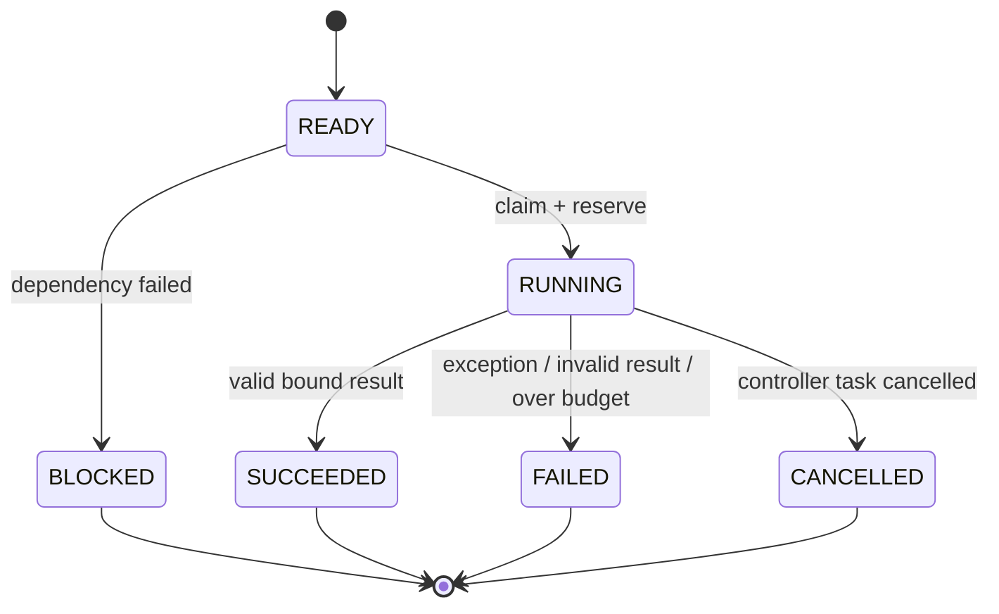

# Graph Controller MVP

## 目标

`GraphController` 是动态图唯一写入者。`AgentNode` 及其模型输出全部视为不可信：节点只能提交 `spawn`、`message`、`skip_context` 提议，Controller 在同一归并边界重新验证后才物化节点或边。

## 图与调度语义

- `spawn`：父节点到子节点的执行/谱系边；子节点继承父节点工具白名单的子集、代数和预算切片。
- `depends_on`：显式 DAG 依赖；仅能添加到尚未运行的 `READY` 目标节点。
- `message`：被动上下文边，不触发目标节点执行。
- `skip_context`：指向后代的跨代上下文边，不触发执行。
- `priority` 只决定 frontier 内的稳定调度顺序；`budget_share` 只决定子节点 Token 配额；`weight` 只表示上下文门控。三者不混用。

每个 super-step 会冻结 ready frontier，并发执行后按 Controller 分配的 sequence 稳定归并。因此完成先后不会改变图状态。新节点进入下一 step；同一 `run_id` 的调度入口由 single-flight lock 串行化。

## 状态机

预算由 Controller 单一账本管理。节点创建时预留最坏 Token 上限；成功按实际 usage 提交并释放未使用额度；异常、非法结果或超出预留时按保守规则提交整笔预留；取消和依赖阻塞会释放预留。

## 信任边界

Controller 摄取结果时会验证：

- 执行节点与 `AgentResult.node_id` 一致；
- Node 事件链非空、长度有界、节点一致、首尾状态合法；
- 终态事件 `result_hash` 绑定 output、usage、error 和三类 proposals；
- token 必须为非负、非 bool、有界整数；
- proposal 数量、ID、文本、TTL 和权重有界且 finite；
- 子节点工具权限、代数、fan-out、全局节点/边/Token 上限均合法；
- 执行边保持 DAG；context 边不参与调度。

无效结果整体 fail-closed，不会部分采纳其中的提议。公开 API 不提供“抢先提交任意运行中结果”的入口；当前 MVP 只支持 Controller 内部 runner。

## Checkpoint 与恢复

`checkpoint()` 输出 canonical JSON，包含 Controller 自己维护的 hash-chain 事件和完整快照。`replay_checkpoint()` 不调用 Agent、模型、工具或 factory，仅恢复最后一个经过验证的快照；恢复时会校验重复 ID、边端点、执行引用、预算和 pending/status 一致性。

当前事件以完整快照作为权威恢复记录，这属于 snapshot replay，不是对每个领域 mutation 的逐事件归约。SHA-256 链只能检测意外损坏或链内篡改，不能证明来源；跨主机/跨信任域部署必须增加 HMAC/KMS 签名和持久化 head 锚定。

## MVP 边界

- 单进程、内存态，不支持分布式 worker；
- checkpoint 可导出/验证，但尚无 SQLite 事务存储与运行中 resume；
- 不支持运行中修改 frontier、自动 retry、人工审批或 all/any fan-in；
- 同步 factory 在 Controller 临界区调用，应保持快速、可信；
- 外部副作用无法由协程取消回滚，工具需要幂等键或补偿事务。

推荐后续顺序：SQLite barrier checkpoint/resume → 人工审批 pause/resume → all/any join 与受控循环 → 分布式租约 worker → weighted quorum。
