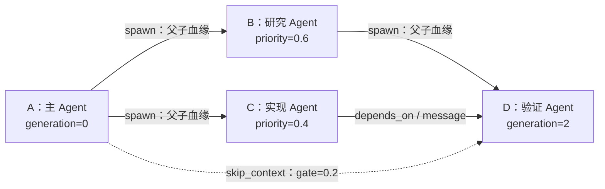
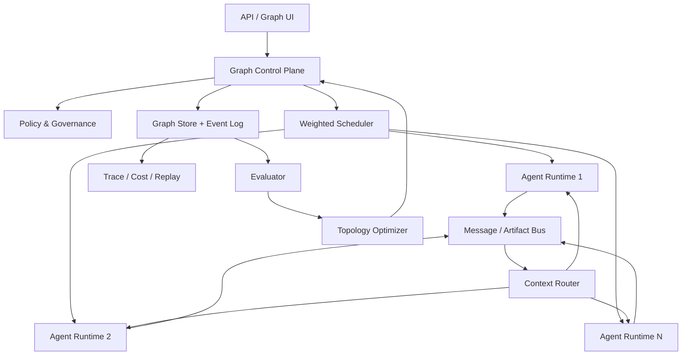

# Graph Agent：开源项目调研与方案可行性评估

> 调研日期：2026-08-14
>
> 调研范围：图结构多 Agent、动态 Agent 生成、递归子 Agent、通信拓扑优化、边权重、跨层或跳跃连接，以及相关运行时框架。

## 摘要

本项目设想将每个 Agent 表示为图中的一个节点。Agent 可以在任务执行过程中自主派生子 Agent，形成带有显式父子关系的有向图；父 Agent 可以为不同子 Agent 分配不同的重要性、预算或可信度权重；Agent 之间还可以建立跨代连接，使祖先或旁支 Agent 的信息跳过中间层，直接影响后代 Agent。

截至调研日期，已经存在大量相邻项目，但尚未发现一个成熟的开源框架能够同时原生支持以下全部能力：

1. Agent 是图中的一等节点；
2. Agent 可以在运行时递归派生新的 Agent；
3. 系统持久记录不可变的父子血缘；
4. 通信边或依赖边具有可解释、可调整或可学习的权重；
5. 支持跨代语义跳连；
6. 图拓扑可以根据执行反馈持续演化；
7. 具备预算、权限、并发控制、回放和可观测性等生产级能力。

现有生态大致分为两条路线：

- **递归 Agent 运行时**：擅长派生子 Agent、任务递归拆解和结果回传，但通常使用树或层次结构，缺少可学习的任意图拓扑。
- **Agent 图与拓扑优化**：擅长用图组织 Agent、选择节点、生成或剪枝通信边，但通常在执行前构造图，缺少运行过程中由任意 Agent 继续递归派生节点的机制。

因此，本项目在工程上具有较高可行性，其潜在差异化在于将上述两条路线合并为一个可递归自扩展、带类型和权重、支持跨代信息跳连、并能在成本约束下演化拓扑的 **Agent Graph Runtime**。

---

## 1. 项目设想的形式化描述

设 Agent 系统为带属性的有向图：

\[
G_t=(V_t,E_t,X_t,W_t)
\]

其中：

- \(V_t\)：时刻 \(t\) 已存在的 Agent 节点集合；
- \(E_t\)：Agent 之间的有向关系集合；
- \(X_t\)：节点属性，例如角色、模型、工具权限、上下文和运行状态；
- \(W_t\)：边或节点的权重，例如优先级、预算份额、可信度和上下文门控值。

如果 Agent \(u\) 在运行过程中派生 Agent \(v\)，系统产生一个新节点和一条血缘边：

\[
V_{t+1}=V_t\cup\{v\}, \qquad
E_{t+1}=E_t\cup\{(u,v,\text{spawn})\}
\]

如果祖先 Agent \(a\) 的输出绕过中间节点，直接传递给后代 Agent \(d\)，则增加一条跳跃上下文边：

\[
(a,d,\text{skip\_context},w_{ad})
\]

这里的 \(w_{ad}\) 控制祖先信息进入后代上下文的优先级、配额或门控强度。

---

## 2. 总体调研结论

### 2.1 是否已有完全相同的开源项目

**没有发现功能完全重合、同时达到生产可用程度的一站式项目。**

最接近本设想不同部分的项目包括：

- [GPTSwarm](https://github.com/metauto-ai/GPTSwarm)：最接近“Agent 及 Agent 群体均可表示为可优化图”；
- [ROMA](https://github.com/sentient-agi/ROMA)：最接近“递归任务分解与子 Agent 层次”；
- [OpenClaw Sub-agents](https://github.com/openclaw/openclaw/blob/main/docs/tools/subagents.md)：提供较完整的异步子 Agent 生命周期和嵌套控制参考；
- [Sagent](https://github.com/rekursiv-ai/sagent)：最接近“递归派生加跨 Agent 直接通信”；
- [ARG-Designer](https://github.com/Shiy-Li/ARG-Designer)：最接近“根据任务自动决定 Agent 数量、角色和通信拓扑”；
- [DyLAN](https://github.com/SALT-NLP/DyLAN)：最接近“根据贡献评估 Agent 重要性”；
- [AgentPrune](https://github.com/yanweiyue/AgentPrune)：最接近“按价值剪枝通信边”；
- [G-Designer](https://github.com/yanweiyue/GDesigner)：最接近“使用图模型生成任务相关通信拓扑”；
- [Graph-of-Agents](https://github.com/UNITES-Lab/GoA)：最接近“选择 Agent、建立有向关系并进行双向消息传播”；
- [AgentConductor](https://arxiv.org/abs/2602.17100)：最接近“根据任务难度和运行反馈生成分层 DAG”。

### 2.2 项目的主要创新空间

现有项目通常只覆盖下列能力中的一部分：

- 动态生成角色，但不是递归运行时派生；
- 使用有向图，但图在运行前已经确定；
- 有边优化，但没有稳定的父子血缘；
- 有子 Agent 树，但没有任意跨代连接；
- 有重要性分数，但分数不直接统一控制预算、路由和上下文；
- 有实验性拓扑学习，但缺少生产级回放、安全和治理能力。

因此，本项目不需要从零发明所有底层技术，重点应是设计一个统一的图语义、运行时协议和治理机制。

---

## 3. 相关开源项目分析

### 3.1 GPTSwarm

- 项目：[metauto-ai/GPTSwarm](https://github.com/metauto-ai/GPTSwarm)
- 论文：[Language Agents as Optimizable Graphs](https://arxiv.org/abs/2402.16823)
- 定位：将语言 Agent 统一描述为计算图，并优化节点提示词与 Agent 间连接。

GPTSwarm 的核心抽象非常接近本项目的图思想：图节点执行函数、工具调用或 LLM 调用，边表示信息流；一个 Agent 可以由图组成，多个 Agent 又可以递归组合成更大的复合图。其边优化机制可将 Agent 间的连接概率逐渐推向创建或剪枝。

可复用思想：

- Agent 和 Agent 群体的统一图表示；
- 节点级提示词优化；
- 边概率与边创建/剪枝；
- 以任务表现和成本作为图优化目标。

主要差距：

- 一个 Agent 本身更接近“操作节点组成的子图”，不完全等同于本项目中的单一运行实体节点；
- 重点是图优化，而非运行期间任意节点继续派生有独立生命周期的子 Agent；
- 没有把父子血缘、任务依赖、通信关系和运行轨迹明确拆分。

结论：**最适合借鉴其图表示和边优化算法，不宜直接作为完整运行时。**

### 3.2 ROMA

- 项目：[sentient-agi/ROMA](https://github.com/sentient-agi/ROMA)
- 定位：Recursive Open Meta-Agent，使用递归层次结构解决长程复杂任务。

ROMA 使用递归的 plan–execute 过程：Atomizer 判断任务是否原子化；Planner 将复杂任务拆为子任务；子任务重新进入相同流程；Executor 执行原子任务；Aggregator 将子结果汇总为父任务答案。

可复用思想：

- 递归任务分解；
- 父任务向子任务传递目标；
- 子任务结果自底向上聚合；
- 原子任务判断与递归终止；
- Planner、Executor、Aggregator、Verifier 的模块划分。

主要差距：

- 核心结构仍偏向递归树或层次任务图；
- 缺少一等的任意有向通信边；
- 缺少跨代跳连和统一边权学习机制。

结论：**最适合借鉴递归求解循环和父子结果聚合。**

### 3.3 AutoAgents

- 项目：[OWD-AI/AutoAgents](https://github.com/OWD-AI/AutoAgents)
- 论文：[AutoAgents: A Framework for Automatic Agent Generation](https://arxiv.org/abs/2309.17288)
- 定位：根据任务自动生成不同专家角色并组成协作团队。

AutoAgents 的 Planner 根据问题决定需要哪些专家角色及执行计划；Observer 检查 Agent、计划和动作是否合理；专家 Agent 包含名称、专业能力、工具和模型增强配置。

可复用思想：

- 根据任务自动生成 Agent 角色；
- 角色、工具和计划的结构化描述；
- Observer 对生成的 Agent 和计划进行反思；
- AgentBank 或角色库复用。

主要差距：

- Agent 主要在规划阶段生成；
- 没有持续演化的运行时图；
- 缺少父子血缘、跨代连接和边权重机制。

结论：**适合作为“Agent 工厂”和角色生成器的参考。**

### 3.4 ARG-Designer

- 项目：[Shiy-Li/ARG-Designer](https://github.com/Shiy-Li/ARG-Designer)
- 定位：将多 Agent 系统设计建模为条件自回归图生成任务。

ARG-Designer 会根据具体任务依次决定：需要多少 Agent、选择哪些角色、建立哪些通信连接。它是目前与“自动生成 Agent 图”最直接相关的研究代码之一。

可复用思想：

- 按任务复杂度动态决定节点数量；
- 从可扩展角色池选择 Agent；
- 自动生成通信边；
- 将成功图作为训练样本进行微调。

主要差距：

- 更偏向执行前生成一次任务拓扑；
- 训练流程较重，需要冷启动数据生成和微调；
- 尚未覆盖执行中由任意 Agent 继续派生节点的通用生命周期。

结论：**适合用作后期“拓扑生成器”，不适合 MVP 阶段直接成为执行内核。**

### 3.5 DyLAN

- 项目：[SALT-NLP/DyLAN](https://github.com/SALT-NLP/DyLAN)
- 论文：[A Dynamic LLM-Powered Agent Network for Task-Oriented Agent Collaboration](https://arxiv.org/abs/2310.02170)
- 定位：动态选择 Agent 团队，并用 Agent Importance Score 评估贡献。

DyLAN 面向推理与代码生成任务，允许 Agent 多轮交互，并在推理阶段进行 Agent 选择和提前终止。其无监督 Agent Importance Score 可以估计不同 Agent 对最终结果的贡献。

可复用思想：

- Agent 贡献评估；
- 按任务选择团队；
- 多轮交互；
- 提前终止低收益计算。

主要差距：

- 依赖候选 Agent 池；
- 不是以递归派生和持久血缘为核心；
- 更像研究实验代码，而非通用生产运行时。

结论：**适合设计节点重要性和信用分配的初始算法。**

### 3.6 AgentPrune

- 项目：[yanweiyue/AgentPrune](https://github.com/yanweiyue/AgentPrune)
- 论文：[Cut the Crap: An Economical Communication Pipeline for LLM-based Multi-Agent Systems](https://arxiv.org/abs/2410.02506)
- 定位：识别多 Agent 通信冗余，对时空消息传递图进行一次性剪枝。

AgentPrune 可以删除冗余甚至恶意的通信消息，并展示了与 AutoGen 和 GPTSwarm 思路结合的实验。其核心价值是说明：Agent 数量或边数量越多，并不必然越好；稀疏高价值通信通常更经济、更稳健。

可复用思想：

- 空间边和时间边分开建模；
- 按通信价值剪枝；
- 对恶意或低贡献 Agent 断边；
- 将质量、token 成本与安全性联合评价。

主要差距：

- 重点是对已有通信图做剪枝；
- 不负责运行时生成新 Agent；
- 缺少持久的父子图和通用调度系统。

结论：**适合成为后期图优化器或周期性垃圾回收器。**

### 3.7 G-Designer

- 项目：[yanweiyue/GDesigner](https://github.com/yanweiyue/GDesigner)
- 论文：[G-Designer: Architecting Multi-agent Communication Topologies via Graph Neural Networks](https://arxiv.org/abs/2410.11782)
- 定位：使用变分图自编码器生成任务相关的通信拓扑。

G-Designer 将多个 Agent 和任务相关虚拟节点编码成图，再解码出适合该任务的通信结构。其目标是在准确率、token 消耗和对抗鲁棒性之间取得平衡。

可复用思想：

- 节点角色和任务信息的向量编码；
- 任务条件化拓扑生成；
- 使用稀疏拓扑降低成本；
- 学习式连边而非完全依赖人工规则。

主要差距：

- 重点是选择通信拓扑；
- 不负责递归子 Agent 生命周期；
- 引入训练后，系统调试和解释成本明显增加。

结论：**适合数据积累后的第二阶段研究，不建议作为第一版依赖。**

### 3.8 Graph-of-Agents

- 项目：[UNITES-Lab/GoA](https://github.com/UNITES-Lab/GoA)
- 论文：[Graph-of-Agents: A Graph-based Framework for Multi-Agent LLM Collaboration](https://arxiv.org/abs/2604.17148)
- 定位：从 Agent 池中选择相关模型，构造有向图并进行图消息传播。

GoA 先根据模型卡选择相关 Agent，再根据相互响应的相关性建立有向边；随后从高相关 Agent 向低相关 Agent 正向传播消息，再反向传播以进一步修正原始答案，最后通过图池化聚合输出。

可复用思想：

- 使用模型卡描述 Agent 能力；
- 任务相关的节点选择；
- 基于响应相关性的有向连边；
- 正向和反向消息传递；
- 图池化结果聚合。

主要差距：

- Agent 来源于既有模型池；
- 重点是测试时协作，不是自主演化的持久运行时；
- 对运行资源要求较高，官方实验需要并行部署多个模型。

结论：**适合借鉴能力发现、相关性连边和结果聚合。**

### 3.9 MacNet

- 项目：[OpenBMB/ChatDev 的 macnet 分支](https://github.com/OpenBMB/ChatDev/tree/macnet)
- 论文：[Scaling Large Language Model-based Multi-Agent Collaboration](https://arxiv.org/abs/2406.07155)
- 定位：使用 DAG 组织大量 Agent，并按拓扑顺序完成协作推理。

MacNet 的研究证明，DAG 可以支持大规模 Agent 网络，并且不规则拓扑可能优于规则拓扑。它允许生成不同节点数量和不同形状的图，然后按拓扑序执行。

可复用思想：

- DAG 调度与拓扑排序；
- 大规模 Agent 图的可扩展性实验；
- 多个前驱结果的聚合；
- 图深度、节点规模和拓扑形状对表现的影响。

主要差距：

- 图通常在运行前生成；
- 不强调父子血缘和运行时递归派生；
- 缺少统一的权重、权限和预算语义。

结论：**适合用作大规模 DAG 执行和基准测试参考。**

### 3.10 LangGraph

- 项目：[langchain-ai/langgraph](https://github.com/langchain-ai/langgraph)
- 文档：[Workflows and agents](https://docs.langchain.com/oss/python/langgraph/workflows-agents)
- 定位：有状态图工作流和 Agent 运行时。

LangGraph 支持持久化、流式输出、断点恢复、条件边和循环。其 `Send` API 可以根据规划结果动态创建多个 worker 执行实例，每个 worker 有独立状态，输出可写入共享状态并由调度节点汇总。

可复用思想：

- 状态图执行器；
- 动态 fan-out；
- 检查点与故障恢复；
- Human-in-the-loop；
- 流式运行和可观测性集成。

主要差距：

- 动态创建的通常是预定义节点类型的运行实例；
- 父子血缘、权重语义和跨代跳连仍需自行设计；
- 若直接把 LangGraph 的内部图当作唯一事实来源，会限制图模式演化。

结论：**是 MVP 执行器的优先候选，但控制面和持久图模型应由项目自己掌握。**

### 3.11 AutoGen GraphFlow

- 项目：[microsoft/autogen](https://github.com/microsoft/autogen)
- 文档：[GraphFlow](https://microsoft.github.io/autogen/dev/user-guide/agentchat-user-guide/graph-flow.html)
- 定位：用有向图严格控制多个 Agent 的执行顺序。

GraphFlow 将 Agent 表示为节点，边表示允许的执行路径，并支持串行、并行、条件分支和带安全退出条件的循环。

可复用思想：

- Agent 作为有向执行图节点；
- 条件路由；
- 并行分支和循环；
- 执行图与消息过滤图分离。

主要差距：

- 更偏预定义工作流；
- 当前文档仍将 GraphFlow 标记为实验性功能；
- 没有原生学习型边权、父子血缘和递归节点生成。

结论：**适合参考图 API 和消息过滤设计，不建议把实验性 GraphFlow 作为唯一底座。**

### 3.12 OpenClaw 与 Sagent

#### OpenClaw

OpenClaw 的 `sessions_spawn` 支持非阻塞子 Agent 派生、独立会话、完成后向父 Agent 回传、可配置嵌套深度、每个 Agent 的子节点上限和全局并发上限。其设计还强调深度权限、级联停止和防止无限分叉。

值得借鉴：

- 子 Agent 生命周期；
- 会话隔离；
- 派生深度和并发治理；
- 完成事件回传；
- 父 Agent 对子结果进行二次审核。

限制：OpenClaw 的子 Agent 通信受到严格限制，重点是安全的父子回传，并不是可学习的任意 Agent 通信图。

#### Sagent

Sagent 支持递归 Agent 派生，并允许派生后的 Agent 与命名 peer 直接通信，而不局限于父节点。这种“派生树加直接消息边”的结构非常接近本项目的初步运行模型。

值得借鉴：

- 子 Agent 继续派生自己的子 Agent；
- peer-to-peer 消息；
- 异步、可中断和可分离任务；
- Agent 运行时配置切换。

限制：项目较新，尚缺完整的拓扑学习、图可视化、企业级治理和大规模验证。

---

## 4. 能力对照矩阵

符号说明：✅ 原生或核心能力；△ 可部分实现或需扩展；— 非核心能力或未发现明确支持。

| 项目 | 运行时派生 | 递归父子关系 | 有向 Agent 图 | 权重/重要性 | 跨层或直接通信 | 自动拓扑优化 | 生产运行时能力 |
|---|---:|---:|---:|---:|---:|---:|---:|
| GPTSwarm | △ | △ | ✅ | ✅ | ✅ | ✅ | △ |
| ROMA | ✅ | ✅ | △ | — | △ | — | △ |
| AutoAgents | △ | △ | △ | — | — | △ | △ |
| ARG-Designer | △ | — | ✅ | △ | ✅ | ✅ | — |
| DyLAN | — | — | ✅ | ✅ | △ | ✅ | — |
| AgentPrune | — | — | ✅ | ✅ | △ | ✅ | — |
| G-Designer | — | — | ✅ | ✅ | ✅ | ✅ | — |
| Graph-of-Agents | — | — | ✅ | ✅ | ✅ | ✅ | — |
| MacNet | — | — | ✅ | — | ✅ | △ | △ |
| LangGraph | △ | △ | ✅ | △ | ✅ | △ | ✅ |
| AutoGen GraphFlow | — | — | ✅ | △ | ✅ | △ | △ |
| OpenClaw | ✅ | ✅ | △ | △ | △ | — | ✅ |
| Sagent | ✅ | ✅ | △ | △ | ✅ | — | △ |

矩阵表明：可以从现有项目复用大量机制，但“递归运行时”和“学习型图结构”之间仍存在明显空白。

---

## 5. 推荐的图语义

### 5.1 不要把所有关系塞进同一类边

父子血缘、任务依赖、消息通信和实际执行因果具有不同约束。如果统一使用一种 `edge`，系统很快会遇到语义不清、错误环路和无法回放的问题。

建议至少区分以下四类图：

1. **血缘图 `spawn_graph`**
   - 表示谁派生了谁；
   - 创建后不可修改；
   - 必须是 DAG；
   - 用于权限继承、预算追踪和责任归因。

2. **任务依赖图 `dependency_graph`**
   - 表示任务执行的先后条件；
   - 必须是 DAG；
   - 用于调度、重试和阻塞判断。

3. **通信图 `message_graph`**
   - 表示哪些 Agent 可以向哪些 Agent 发送信息；
   - 可以有环；
   - 必须有轮次、消息 TTL、大小限制和权限控制。

4. **执行轨迹图 `execution_graph`**
   - 记录每次实际模型调用、工具调用、消息发送和结果消费；
   - 应当只追加、不覆盖；
   - 用于审计、回放、成本核算和信用分配。

在存储层可以使用统一的属性图模型，但边必须带有明确的 `edge_type`，并由不同验证规则约束。

### 5.2 推荐结构示意



### 5.3 处理通信环路

通信关系允许循环，例如 reviewer 将意见发回 writer。为保证实际执行轨迹可回放，可以将运行节点展开为：

\[
(agent\_id, round, invocation\_id)
\]

这样即使逻辑通信图存在 \(A\rightarrow B\rightarrow A\)，实际事件仍按时间形成无环因果图：

\[
A_1\rightarrow B_1\rightarrow A_2
\]

---

## 6. 节点与边的数据模型

### 6.1 Agent 节点

```yaml
AgentNode:
  id: uuid
  run_id: uuid
  parent_id: uuid | null
  generation: integer
  role: string
  objective: string
  model_profile: string
  tool_policy_id: string
  context_policy_id: string
  budget:
    token_limit: integer
    cost_limit: number
    time_limit_seconds: integer
  status: proposed | ready | running | waiting | succeeded | failed | cancelled
  created_by: agent_id | system | human
  created_at: timestamp
```

### 6.2 Agent 边

```yaml
AgentEdge:
  id: uuid
  run_id: uuid
  source: agent_id
  target: agent_id
  type: spawn | depends_on | message | skip_context | review | aggregate
  priority: number
  budget_share: number | null
  context_gate: number | null
  trust: number | null
  active: boolean
  created_by: agent_id | optimizer | human | system
  valid_from: timestamp
  valid_to: timestamp | null
```

### 6.3 运行事件

```yaml
RunEvent:
  sequence: integer
  event_id: uuid
  run_id: uuid
  node_id: uuid
  type: spawn_proposed | spawn_accepted | model_called | tool_called |
        message_sent | output_produced | score_recorded | node_terminated
  input_hash: string | null
  output_ref: string | null
  tokens: integer
  cost: number
  latency_ms: integer
  created_at: timestamp
```

建议使用事件溯源思路：图的当前状态可以由事件投影得到，而原始事件不可覆盖。这样可以准确回答“哪个 Agent 为什么出现”“某条边何时创建”“某次拓扑调整是否提升结果”等问题。

---

## 7. 权重设计

“主 Agent 给子 Agent 分配权重”不应只实现成一个模糊数字。至少需要区分四类含义。

### 7.1 优先级 `priority`

决定同一时刻多个就绪节点的执行顺序，但不应直接代表可信度。

### 7.2 预算份额 `budget_share`

决定 token、调用次数、时间或金额预算。例如：

\[
B_i=B_{total}\cdot
\operatorname{softmax}(p_i/\tau)
\]

其中 \(p_i\) 为子 Agent 优先级，\(\tau\) 控制预算分配的集中程度。

### 7.3 上下文门控 `context_gate`

决定某条边的信息能以多大配额进入目标 Agent 上下文。对于黑盒 LLM API，它通常不表示向量乘法，而表示：

- 是否进入上下文；
- 可占用多少 token；
- 使用原文还是摘要；
- 在上下文中的排序位置；
- 是否必须通过 verifier。

### 7.4 动态可信度 `trust`

根据 Agent 历史正确率、验证结果、事实一致性和任务相关性动态更新。建议初期使用可解释的指数移动平均：

\[
trust_i^{(t+1)}=(1-\alpha)trust_i^{(t)}+\alpha reward_i^{(t)}
\]

信息路由分数可以设计为：

\[
s_{u\rightarrow v}
=priority_u\cdot relevance(u,v)\cdot trust_u
\]

然后只选择 Top-K 输入或在 token 预算内完成近似背包选择，以避免全连接图导致上下文和调用成本平方增长。

---

## 8. “残差连接”的工程定义

### 8.1 黑盒 API 条件下

使用 OpenAI、Anthropic、Gemini 等黑盒模型 API 时，系统无法访问模型内部隐藏状态，因此不能真正实现神经网络意义上的：

\[
h_{l+1}=F(h_l)+h_l
\]

实际可实现的是 **语义级跳连**：保留目标 Agent 自己的工作上下文，同时把祖先或旁支 Agent 的输出经过过滤、摘要和门控后直接注入目标 Agent。

因此，建议命名为：

- `skip_context`；
- `bypass_edge`；
- `ancestor_context`。

避免在工程文档中直接称为神经网络残差连接，以免混淆。

### 8.2 推荐的跳连管线

```text
祖先或旁支输出
    ↓
相关性过滤
    ↓
安全检查与指令隔离
    ↓
结构化摘要
    ↓
按 context_gate 分配 token
    ↓
以“证据/建议”而非“系统指令”注入目标 Agent
```

### 8.3 真正隐藏状态残差的条件

如果未来确实要实现张量级残差，则需要：

- 自托管同构开源模型；
- 修改模型 forward 过程；
- 统一 tokenizer、层结构和隐藏维度；
- Agent 节点之间共享张量接口；
- 端到端可微训练和大量 GPU 资源。

这会使项目从 Agent 编排系统转变为模型架构研究。除非项目目标明确包含模型训练，否则不建议在早期阶段采用。

---

## 9. 推荐系统架构



### 9.1 Graph Control Plane

负责节点、边和图版本的创建与验证。Agent 不应直接修改数据库，而应提交结构化提议：

```yaml
SpawnProposal:
  parent_id: agent-123
  role: security_reviewer
  objective: review generated code for vulnerabilities
  requested_budget: 12000
  requested_tools:
    - code_read
    - test_run
  proposed_edges:
    - target: implementation-agent
      type: review
```

控制面检查通过后，才将提议转化为真实节点和边。

### 9.2 Weighted Scheduler

调度器综合考虑：

- 依赖是否满足；
- 节点优先级；
- 剩余预算；
- 预计成本和时延；
- Agent 可信度；
- 模型和工具的并发上限；
- 相同任务是否已由其他节点执行。

### 9.3 Context Router

负责在通信图和 token 预算约束下为目标 Agent 组装上下文，包括：

- 父节点任务说明；
- 直接前驱结果；
- 允许的跨代结果；
- 共享事实和产物；
- 消息来源、可信度和时间戳；
- 不可信内容的指令隔离。

### 9.4 Evaluator 与 Topology Optimizer

Evaluator 产生节点级、边级和任务级评价。Topology Optimizer 根据历史结果执行：

- 降低低收益边的权重；
- 剪除长期冗余边；
- 提升高贡献 Agent 的预算；
- 发现高价值跨代连接；
- 对重复失败的派生模式设置限制。

第一版应使用规则和统计方法；积累足够评测数据后再尝试 contextual bandit、贝叶斯优化、强化学习或图生成模型。

---

## 10. 技术选型建议

### 10.1 推荐组合

| 层次 | MVP 建议 | 原因 |
|---|---|---|
| 编程语言 | Python 3.12 | Agent 与研究生态成熟，异步和数据建模工具丰富 |
| API | FastAPI | 原生异步、类型明确、便于生成 OpenAPI |
| 数据模型 | Pydantic | 适合约束 Agent 提交的节点与边提议 |
| 执行器 | LangGraph 或自研轻量 async runtime | 前者提供检查点，自研控制面保持领域独立 |
| 关系数据库 | PostgreSQL | 事务、事件记录和生产运维成熟 |
| 图查询 | MVP 使用 PostgreSQL；必要时再引入 Neo4j | 早期图规模通常不需要独立图数据库 |
| 消息系统 | MVP 使用进程内队列；扩展后使用 Redis Streams/NATS | 避免第一版基础设施过重 |
| 观测 | OpenTelemetry | 统一模型调用、工具调用、消息和成本 trace |
| 前端图可视化 | React Flow 或 Cytoscape.js | 支持动态节点、边、状态和交互 |
| 模型接入 | 统一 Provider Adapter | 避免运行时绑定单一模型服务商 |

### 10.2 为什么不建议第一版直接使用 Neo4j

项目最先需要的是事务性状态、事件日志、预算扣减和任务锁，而不是复杂离线图算法。PostgreSQL 的节点表、边表和递归 CTE 足以支撑早期规模。只有出现以下需求时再引入 Neo4j：

- 跨大量历史 run 做多跳模式发现；
- 实时计算复杂中心性或社区；
- 图查询成为核心产品功能；
- PostgreSQL 递归查询已成为明确瓶颈。

---

## 11. 安全与治理

## 11.1 Agent 只能提议，控制器负责执行

Agent 不得直接创建数据库记录、提高自己的预算、扩大工具权限或绕过父节点。所有图变更必须经过确定性控制器验证。

## 11.2 权限只能默认收缩

子 Agent 的工具权限默认应满足：

\[
Permissions(child)\subseteq Permissions(parent)
\]

权限扩大必须由可信策略或人工批准。

## 11.3 必须设置的硬限制

- `max_depth`：最大派生深度；
- `max_nodes_per_run`：单次任务最大 Agent 数；
- `max_children_per_agent`：单 Agent 最大直接子节点数；
- `max_concurrency`：全局并发上限；
- `max_total_tokens`：总 token 限额；
- `max_total_cost`：总金额限额；
- `max_wall_time`：总运行时间；
- 单节点超时、重试次数和失败熔断；
- 血缘图、依赖图的环路检测；
- 消息 TTL、长度和发送频率限制。

## 11.4 跨 Agent 提示注入

一个 Agent 的输出可能含有恶意指令。下游 Agent 必须把其他 Agent 的输出视为不可信数据，而不是高优先级指令。消息应带来源和类型，并通过结构化通道传递：

```yaml
incoming_context:
  source_agent: research-7
  trust: 0.72
  content_type: evidence
  content: "..."
  executable_instruction: false
```

---

## 12. 实现可行性评估

| 能力 | 可行性 | 评价 |
|---|---:|---|
| 递归派生与父子关系 | 9/10 | 常规工程问题，已有多个参考运行时 |
| 动态有向图调度 | 9/10 | 图算法、异步调度和持久化技术成熟 |
| 手工权重与预算分配 | 9/10 | 实现直接，难点在于语义定义而非代码 |
| 跨代语义跳连 | 8/10 | 容易实现，但必须控制上下文、安全和重复信息 |
| 自动学习边权 | 6/10 | 可行，但评价噪声和信用分配较困难 |
| 自主演化近似最优拓扑 | 5/10 | 属于研究问题，需要大量评测数据和稳定奖励 |
| 隐藏状态级残差连接 | 3/10 | 仅适合自托管模型和模型级研究 |

### 12.1 总体判断

- **工程可行性：高。** 动态节点、DAG 调度、事件记录、权重路由均有成熟基础技术。
- **研究可行性：中高。** 自动拓扑学习已有 GPTSwarm、AgentPrune、G-Designer、ARG-Designer 等工作支撑。
- **产品风险：中等。** 主要风险来自成本失控、提示注入、不可解释调度、循环等待和共享工具竞态。
- **差异化潜力：较高。** 当前缺少将递归 Agent 生命周期与动态图优化统一起来的通用运行时。

---

## 13. MVP 路线

### 阶段 0：定义语义与评测基线，约 1 周

- 固定四类边：`spawn`、`depends_on`、`message`、`skip_context`；
- 定义节点状态机；
- 定义预算、权限和终止规则；
- 选择 3—5 类可自动评分任务；
- 建立单 Agent 与固定树基线。

验收条件：相同任务能够用统一事件格式执行和回放。

### 阶段 1：可运行原型，约 2—4 周

- 主 Agent 可以提交 `SpawnProposal`；
- 支持递归子 Agent 和父子血缘；
- 支持并行、依赖等待、失败重试和取消；
- 支持手工 `priority` 与 `budget_share`；
- 使用 PostgreSQL 持久化节点、边和事件；
- 提供 CLI 或基础 API。

验收条件：复杂任务可形成多代 Agent 图，且不会突破深度、节点数和预算限制。

### 阶段 2：跨代连接与图可视化，约 2—3 周

- 支持 `skip_context`；
- Context Router 按相关性和 token 配额组装上下文；
- 可视化节点状态、父子关系、消息边和成本；
- 支持暂停、恢复和运行回放；
- 展示每条边传递的摘要与来源。

验收条件：用户可以解释某个后代 Agent 使用了哪些祖先信息，以及这些信息消耗了多少预算。

### 阶段 3：规则与统计优化，约 3—6 周

- 引入 verifier 和节点贡献评分；
- 使用指数移动平均更新 `trust`；
- 实现 Top-K 路由；
- 对低收益边执行 AgentPrune 式剪枝；
- 引入早停、quorum 和重复任务合并。

验收条件：在相同质量下减少 token 或延迟，或者在相同预算下提高任务质量。

### 阶段 4：学习型拓扑，研究阶段

- contextual bandit 选择角色和边；
- 根据任务难度决定 Agent 数量；
- 从成功运行图生成训练数据；
- 尝试 G-Designer、ARG-Designer 或 RL 风格拓扑生成；
- 在离线评测和影子流量中验证后再开启在线自动改图。

---

## 14. 评测方案

至少比较以下五种配置：

1. 单 Agent；
2. 等权父子树；
3. 带权父子树；
4. 固定跨代跳连图；
5. 动态加边、剪枝和预算分配图。

统一目标函数可定义为：

\[
R=Quality-\lambda Cost-\mu Latency-\nu Failure
\]

建议记录：

- 最终任务质量；
- 总 token 和金额；
- 端到端延迟；
- Agent 数量和最大深度；
- 边数量和图密度；
- 每个 Agent 的边际贡献；
- 失败、超时和重试次数；
- 跳连信息的使用率；
- 恶意或错误 Agent 对最终结果的影响；
- 相同任务多次运行的方差。

适合早期评测的任务：

- 可运行单元测试的代码生成；
- 有确定答案的数学推理；
- 带引用验证的研究任务；
- 多约束规划；
- 文档生成加规则检查；
- 人工注入错误 Agent 的鲁棒性测试。

---

## 15. 主要风险

### 15.1 分叉爆炸

如果每个 Agent 都能生成多个子 Agent，节点数量随深度指数增长。必须把预算作为生成节点的前置条件，而不是执行后的统计项。

### 15.2 上下文爆炸

全连接或大量跨代跳连会使每个节点接收过多内容。需要稀疏连边、摘要缓存、Top-K 路由和 token 背包策略。

### 15.3 信用分配困难

最终结果优秀并不表示每个参与 Agent 都有贡献。节点可能只重复前驱内容，或者某条边只在特定任务上有效。早期应优先使用消融实验和可解释统计，不要过早依赖端到端强化学习。

### 15.4 循环等待和重复劳动

任务依赖必须保持 DAG，并使用任务指纹检测重复子任务。通信循环必须设置轮次和退出条件。

### 15.5 工具副作用竞态

多个 Agent 同时修改文件、数据库或外部系统可能产生冲突。需要工作区隔离、资源锁、幂等键和人工审批。

### 15.6 拓扑学习过拟合

某些图结构可能只对特定 benchmark 或模型组合有效。优化器必须同时在不同任务、不同模型和不同预算下验证。

---

## 16. 时间与人员估算

假设一名熟悉 Python、异步系统和 Agent 框架的工程师全职投入：

- CLI/API 原型：约 3—6 周；
- 加入持久化、恢复、权限和基础可视化：累计约 2—4 个月；
- 形成较稳定的生产运行时：约 4—8 个月，取决于外部工具和多租户需求；
- 自动拓扑学习与严谨实验：单独作为持续研究路线。

如果由 2—3 人协作，推荐角色划分：

- Runtime：调度、状态机、恢复、消息和预算；
- Agent/Research：角色生成、评价、剪枝和拓扑学习；
- UI/Observability：图可视化、trace、成本和回放。

---

## 17. 最终建议

### 17.1 项目定位

不建议只将项目描述为“使用图编排 Agent”，因为 LangGraph、AutoGen、GPTSwarm 等已经覆盖该表述的一部分。更准确的定位是：

> 一个可递归自扩展、具有显式血缘和类型化加权边、支持跨代语义跳连，并能在质量与成本约束下持续演化拓扑的 Agent Graph Runtime。

### 17.2 实现策略

1. 先完成可解释、确定性的图运行时；
2. 使用 LangGraph 等现有执行能力，但保持自己的图控制面和事件模型；
3. 把权重拆成优先级、预算、上下文门控和可信度；
4. 将残差连接实现为可审计的语义跳连；
5. 用规则和统计方法积累数据；
6. 最后再引入自动拓扑生成和强化学习。

### 17.3 可验证的研究问题

项目可以围绕以下问题形成清晰实验：

> 在相同 token、延迟和金额预算下，带有动态权重与稀疏跨代跳连的递归 Agent 图，是否稳定优于单 Agent、树形 Agent 网络、固定 DAG 和全连接 Agent 网络？

这个问题同时具有工程价值和研究价值，也能自然衔接 GPTSwarm、AgentPrune、G-Designer、ARG-Designer、MacNet 和 Graph-of-Agents 等已有工作。

---

## 18. 参考项目与资料

1. [GPTSwarm: Language Agents as Optimizable Graphs](https://github.com/metauto-ai/GPTSwarm)
2. [Language Agents as Optimizable Graphs](https://arxiv.org/abs/2402.16823)
3. [ROMA: Recursive Open Meta-Agents](https://github.com/sentient-agi/ROMA)
4. [AutoAgents](https://github.com/OWD-AI/AutoAgents)
5. [AutoAgents: A Framework for Automatic Agent Generation](https://arxiv.org/abs/2309.17288)
6. [ARG-Designer](https://github.com/Shiy-Li/ARG-Designer)
7. [DyLAN](https://github.com/SALT-NLP/DyLAN)
8. [A Dynamic LLM-Powered Agent Network for Task-Oriented Agent Collaboration](https://arxiv.org/abs/2310.02170)
9. [AgentPrune](https://github.com/yanweiyue/AgentPrune)
10. [Cut the Crap: An Economical Communication Pipeline for LLM-based Multi-Agent Systems](https://arxiv.org/abs/2410.02506)
11. [G-Designer](https://github.com/yanweiyue/GDesigner)
12. [G-Designer: Architecting Multi-agent Communication Topologies via Graph Neural Networks](https://arxiv.org/abs/2410.11782)
13. [Graph-of-Agents](https://github.com/UNITES-Lab/GoA)
14. [Graph-of-Agents: A Graph-based Framework for Multi-Agent LLM Collaboration](https://arxiv.org/abs/2604.17148)
15. [MacNet](https://github.com/OpenBMB/ChatDev/tree/macnet)
16. [Scaling Large Language Model-based Multi-Agent Collaboration](https://arxiv.org/abs/2406.07155)
17. [AgentConductor: Topology Evolution for Multi-Agent Competition-Level Code Generation](https://arxiv.org/abs/2602.17100)
18. [LangGraph：Workflows and agents](https://docs.langchain.com/oss/python/langgraph/workflows-agents)
19. [AutoGen GraphFlow](https://microsoft.github.io/autogen/dev/user-guide/agentchat-user-guide/graph-flow.html)
20. [OpenClaw Sub-agents](https://github.com/openclaw/openclaw/blob/main/docs/tools/subagents.md)
21. [Sagent](https://github.com/rekursiv-ai/sagent)

## 19. 调研说明

本报告依据项目官方 GitHub 仓库、官方文档和论文页面进行交叉整理。项目活跃度、API、许可证和功能可能继续变化；正式选型或直接复用代码前，应再次检查目标仓库的最新版本、许可证文件和安全公告。没有明确开源许可证的论文配套仓库，应默认仅作研究参考，不应直接复制到商业代码中。
