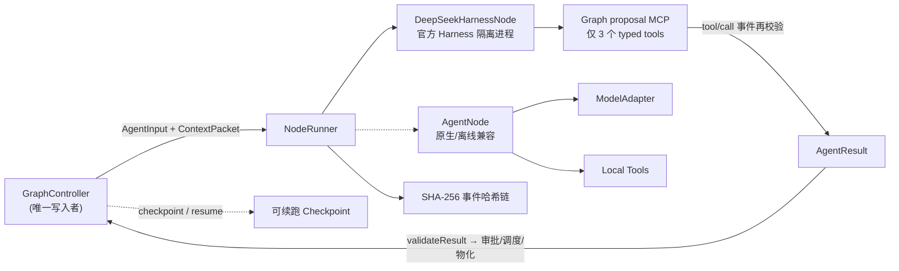

# Graph Agent

一个框架无关的动态图 Multi-Agent 运行时,用 **TypeScript** 全量实现。核心思路:每个 Agent 节点只能提交结构化的图操作**提议**,由唯一的 `GraphController` 在信任边界上重新校验后才物化节点、边与预算;每个节点背后挂一个可崩溃恢复的 **Session**。整套系统可离线运行、可确定性归并、可从断点续跑。

> 本项目最初为 Python MVP,现已全量重构为 TypeScript(`packages/` 下的 npm workspaces)。历史 Python 实现暂留在 `src/graph_agent/` 作参考,不再是主线。

## 架构:两层 + 八包

**上层 DAG 编排** 负责 Agent 之间怎么派生/依赖/协作/分预算;**下层 Session 运行时** 负责单个 Agent 的状态与历史。每个 DAG 节点背后挂一个 Session。



| 包 | 职责 | 依赖 |
|---|---|---|
| `@graph-agent/core` | 纯数据模型、canonical JSON、SHA-256 事件链、结果绑定哈希、fail-closed 守卫 | — |
| `@graph-agent/session` | Session 运行时:Storage(内存/文件同契约)、hash 链消息历史、单 active-run、幂等 WorkLedger、Inbox、崩溃恢复 | core |
| `@graph-agent/orchestrator` | GraphController:提议信任边界(12 条校验)、super-step 归并、单账本预算、controller 事件链、snapshot-replay + **可续跑 checkpoint/resume** | core · session |
| `@graph-agent/adapter` | `ModelAdapter` 接口、`OpenAICompatibleModel`(含 DeepSeek)、`ScriptedModel`、fetch 传输(禁重定向 / 8 MiB 上限 / 超时) | core |
| `@graph-agent/node` | `AgentNode` turn loop、local + graph 提议工具、`SessionBackedMemory`(每节点持久化消息历史) | core · adapter · session |
| `@graph-agent/harness` | 官方 DeepSeek Harness SDK 节点运行时、受限 Graph MCP、进程级取消、事件/用量/提案映射 | core · node · DeepSeek Harness |
| `@graph-agent/web` | 回环-only Studio HTTP 服务、对话 UI、Harness 图编排、checkpoint 端点 | core · orchestrator · node · harness |
| `@graph-agent/cli` | `graph-agent demo \| controller-demo \| ui` | 以上全部 |

**核心安全边界:`AgentNode` 不能直接修改图。** 模型调用 `graph__propose_spawn` / `graph__send_message` / `graph__request_skip_context` 时,只会在 `AgentResult` 里产生提议。GraphController 必须重新执行全局预算、权限、目标节点存在性、循环检测,并用终态事件里的 `result_hash` 绑定 output/usage/error/全部 proposals,才会物化节点或边。任何一项不符即**整体拒绝**(fail-closed,不部分采纳)。

## 快速开始

要求 Node.js 20+。`core/orchestrator/node` 基础层仍只依赖工作区包与 Node 内建模块;Studio 的官方 DeepSeek Harness 路径会安装其完整运行时依赖。

```bash
npm install
npm run build          # tsc 编译全部 workspace
npm test               # vitest,全 8 包
```

离线演示(无需 API Key):

```bash
node packages/cli/dist/cli.js demo             # 单节点 turn loop + 一个派生提议
node packages/cli/dist/cli.js controller-demo  # 完整 GraphController:多代 spawn 收敛
```

启动本地 Studio:

```bash
node packages/cli/dist/cli.js ui               # 默认 127.0.0.1:8765
#   --host 127.0.0.1|localhost   --port <0-65535>   --no-browser
```

进入页面后点「配置 DeepSeek API」填入你的 Key,选 `deepseek-v4-flash` 或 `deepseek-v4-pro`。主界面是任务对话(`Enter` 发送、`Shift+Enter` 换行);每次提交由真实 DeepSeek 主 Agent 执行,并自主判断是否提出子 Agent 派生请求。「执行图」视图展示该轮动态拓扑、节点输出、实际 Token、预算结算、Controller 哈希链。节点通过官方 DeepSeek Harness SDK 调用 `deepseek-official` provider,消耗对应额度。

线上 DeepSeek 路径已由官方 Harness 接管模型循环;GraphController 仍是唯一图写入者。Harness 自带 Shell/PTY、资源浏览和 subagent 均未开放,只挂载 3 个 proposal MCP 工具;Abort/超时/turn/tool budget 通过关闭该节点隔离进程强制终止。完整边界见 [DeepSeek Harness 节点运行时](docs/DEEPSEEK_HARNESS.md)。

## Checkpoint 与断点续跑

`checkpoint(runId)` 存一份**只读审计快照**(拓扑 + 预算 + 事件链 digest),`replayCheckpoint` 纯重建校验、不调用 factory。

`checkpointResumable(runId)` 额外存一份 **v2 可续跑状态**:每节点的 spec/input/reservation + 每个已完成 execution 的归档 `AgentResult` + 每节点 Session 的消息历史(落 FileStorage,hash 链)。`resumeController(json, factory, { rehydrateSpec })` 从它重建 controller:

- **已完成节点** —— 从归档结果直接重放,**不重跑 runner、不重复扣预算**;
- **未完成 / 中断节点** —— 用 factory 重建 runner,`runUntilIdle` 继续跑至收敛;
- 前置校验 fail-closed(spec/input/result 可重建、archivedResults 节点∈拓扑、Σ预留 == 快照 reservedTokens、committed+reserved ≤ limit),任一不符即拒绝(不半重建)。

Studio 提供 `POST/GET /api/checkpoints`、`GET /api/checkpoints/{id}`(id 受 `^[0-9a-f]{64}$` 守卫防路径穿越)、`POST /api/checkpoints/resume`,左侧 **Checkpoints 面板**支持保存 / 只读查看 / 续跑。

## 编程示例

用适配器 + 节点跑一个 Agent turn(TypeScript):

```ts
import { OpenAICompatibleModel } from "@graph-agent/adapter";
import { AgentNode, createAgentSpec, FunctionTool } from "@graph-agent/node";
import { createAgentIdentity, createNodeBudget, createAgentInput } from "@graph-agent/core";

const model = new OpenAICompatibleModel({ model: "your-model" }); // 官方端点从 OPENAI_API_KEY 读 key
const node = new AgentNode({
  spec: createAgentSpec({
    identity: createAgentIdentity({ nodeId: "root-1", name: "Universal Agent", role: "generalist" }),
    budget: createNodeBudget({ maxTurns: 4, maxToolCalls: 4, maxTotalTokens: 12000, timeoutSeconds: 60 }),
    instructions: "完成任务;需要独立验证时提出子 Agent 派生提议。",
    policy: { maxGeneration: 2, maxChildren: 2, allowDirectMessages: false, allowSkipContext: false },
  }),
  model,
  tools: [new FunctionTool({
    name: "search_local",
    description: "Search a trusted local index",
    inputSchema: { type: "object", properties: { query: { type: "string" } }, required: ["query"] },
    fn: ({ query }) => `local result for: ${query}`,
  })],
});

const result = await node.run(createAgentInput({ task: "研究图 Agent 的实现模式" }));
console.log(result.output, result.spawnProposals);
```

官方 OpenAI 端点默认读 `OPENAI_API_KEY`;自定义远程端点必须 HTTPS(非回环),且**不会**自动继承 `OPENAI_API_KEY`(避免误发),显式传 `apiKey`。

## 节点协议

`AgentNode.run(agentInput, signal?)` 返回 `AgentResult`:`output` / `usage`(累计 in/out Token)/ `spawnProposals` / `messageProposals` / `skipContextProposals` / `events`(可验证事件链,只留摘要与元数据)/ `error`(code + 脱敏 message + retryable)。终态事件的 `result_hash = resultBindingHash(...)` 绑定整个结果,GraphController 摄取时重算校验。

## 测试与构建

```bash
npm test                              # vitest run,全 8 包(540 用例)
npx vitest run packages/<pkg>/        # 单包
npm run build                         # tsc 全 workspace(严格模式)
npm run typecheck
```

## 安全约束

- 模型输出与跨节点上下文一律视为**不可信**;子 Agent 只能申请父节点已有的工具;子预算份额累计 ≤ 1.0。
- DeepSeek Harness 每节点独立启动;上游 `sdk-minimal` 的 danger-full-access Shell/PTY 被 overlay 禁用,且不启用 Harness 内建 subagent。
- Harness 只接收白名单环境变量;DeepSeek API Key 不进入提示词、事件、checkpoint、快照或日志,节点完成后临时 home 被清理。
- 工具/节点异常对模型返回脱敏信息;API Key 不进事件链、不进 checkpoint、不进导出快照、不进日志,适配器 `repr`/序列化隐藏。
- 事件链(SHA-256)用于防篡改检测,非数字签名;跨机部署应加 HMAC/KMS 签名。
- GraphController 摄取边界重校验结果 schema + `result_hash` 绑定;message/skip-context 只存内容 SHA-256,不存明文。
- checkpoint 严格 JSON:拒重复键 / NaN / Infinity / 不可能的图-预算状态;v2 resume 前置全量 fail-closed 校验。
- Web Studio 仅监听回环、严格 JSON 请求边界、请求体上限、self-only CSP、跨站请求 403;checkpoint id 十六进制守卫防路径穿越;DeepSeek 固定 HTTPS 端点 + 模型白名单 + 并发/超时/输出上限。
- 超时可取消 Agent,但无法回滚已开始的外部副作用;有写操作的工具应用幂等键或补偿事务。

## 目录

```text
packages/core/          纯数据模型 + 事件链 + canonical JSON
packages/session/       Session 运行时(存储/消息历史/崩溃恢复)
packages/orchestrator/  GraphController + checkpoint/resume
packages/adapter/       LLM 适配器(OpenAI 兼容 / DeepSeek)
packages/node/          AgentNode + 工具 + SessionBackedMemory
packages/harness/       DeepSeek Harness NodeRunner + 受限 Graph MCP
packages/web/           Studio HTTP 服务 + web_ui 资源
packages/cli/           graph-agent CLI
docs/superpowers/       各子项目的设计 spec 与实现计划
src/graph_agent/         历史 Python MVP(参考,非主线)
GRAPH_CONTROLLER.md      Controller 状态机与信任边界
THIRD_PARTY_NOTICES.md
```

## 许可证与归属

本项目声明采用 Apache-2.0。上游参考项目的来源、快照版本与许可证见 [THIRD_PARTY_NOTICES.md](THIRD_PARTY_NOTICES.md)。
