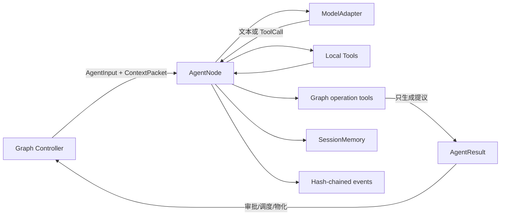

# Graph Agent Node

一个框架无关的动态图 Agent MVP。它同时提供通用 `AgentNode` 与单进程 `GraphController`：节点负责模型调用、工具循环、会话记忆和结构化图提议；Controller 负责审批、预算、拓扑、并发调度和可验证恢复。

当前实现借鉴了 `awesome-llm-apps` 中的轻量 Agent、上下文、会话、agents-as-tools、并行编排与信任门控模式，但没有把某个具体 Agent SDK 固化为核心依赖。

## 已实现

- 框架无关的 `AgentNode`、`ModelAdapter`、`Tool` 和结构化结果协议；
- 普通工具调用循环，支持同步与异步 Python 函数；
- `ScriptedModel` 离线适配器和 OpenAI-compatible Chat Completions 适配器；
- 按 `node_id + session_id` 隔离的会话记忆；
- 最大轮次、工具调用数、Token 数和超时预算；
- 三种图操作提议：派生子 Agent、定向消息、跨代上下文请求；
- 子节点代数、数量、工具权限和累计预算份额门控；
- 输入/输出摘要化的 SHA-256 事件哈希链，可验证但不记录明文；
- 结构化失败结果和离线 CLI 演示；
- super-step 并发调度、确定性结果归并和同一 run 的 single-flight 保护；
- 父子边、DAG 依赖边，以及不触发执行的 message/skip-context 边；
- Controller 级节点/边/深度/并发/Token 预算和工具权限门控；
- 严格 JSON checkpoint、语义不变量验证和无副作用快照恢复；
- Codex 风格的本地 Graph Agent Studio，以多轮任务对话为主界面，并把每轮真实 Controller 执行图作为可审计的辅助视图。



核心安全边界是：`AgentNode` **不能直接修改图**。模型调用 `graph__propose_spawn`、`graph__send_message` 或 `graph__request_skip_context` 时，只会在 `AgentResult` 中产生提议。Graph Controller 必须再次执行全局预算、权限、目标节点存在性和循环检测，然后才能创建节点或边。

## 快速开始

要求 Python 3.11 或更高版本。核心包没有第三方运行时依赖。

```bash
python3 -m pip install .
graph-agent demo
```

也可以不安装直接运行：

```bash
PYTHONPATH=src python3 -m graph_agent.cli demo
```

演示完全离线，不需要 API Key。输出包含计算结果、一个子 Agent 派生提议以及事件链验证结果。

运行完整 Controller 演示：

```bash
PYTHONPATH=src python3 -m graph_agent.cli controller-demo
```

启动本地可视化工作台：

```bash
PYTHONPATH=src python3 -m graph_agent.cli ui
```

安装后也可以直接运行 `graph-agent ui`。服务默认只监听 `127.0.0.1:8765` 并自动打开浏览器；可用 `--port` 更换端口，或用 `--no-browser` 禁止自动打开。

进入页面后点击“配置 DeepSeek API”，填入自己的 API Key，并选择 `deepseek-v4-flash` 或 `deepseek-v4-pro`。主界面是任务对话：同一个左侧任务可连续进行多轮交流，按 `Enter` 发送、`Shift + Enter` 换行；每次提交都会让真实 DeepSeek 主 Agent 执行当前任务，并由它自主判断是否通过 `graph__propose_spawn` 派生最多两个真实子 Agent。点击左侧“执行图”或每轮回复下方的“查看执行图”，可以检查该轮动态拓扑、节点输出、实际 Token、预算结算和 Controller 哈希链。调用固定使用 DeepSeek 官方 `https://api.deepseek.com/chat/completions`，会消耗对应账户额度。

当前 DeepSeek 图工具循环显式使用非思考模式。DeepSeek V4 的思考模式要求在工具调用后的每个请求中完整回传 `reasoning_content`，而通用 `ModelResponse` 协议尚未承载该字段；禁用思考模式可以保持多轮工具调用正确且避免远端 400。接口与模型约束以 [DeepSeek Chat Completion](https://api-docs.deepseek.com/api/create-chat-completion) 和 [DeepSeek Thinking Mode](https://api-docs.deepseek.com/guides/thinking_mode) 为准。

API Key 和页面任务列表只驻留于当前页面的 JavaScript 内存；API Key 随单次请求发送到回环地址上的本机服务，对话历史经过严格的角色、长度和总量校验后作为不可信上下文传给 Agent。密钥不会进入 `localStorage`、对话历史、节点事件、Controller checkpoint、导出快照或服务日志。关闭或刷新页面即清除，界面也提供显式“清除密钥”操作。请只在可信本机上运行工作台。

## Graph Controller

```python
controller = GraphController(
    factory=my_node_factory,
    policy=ControllerPolicy(
        max_nodes=64,
        max_edges=256,
        max_generation=4,
        max_total_tokens=64_000,
        max_concurrency=4,
    ),
)
run_id = await controller.create_run(
    root=root_node,
    agent_input=AgentInput(task="完成任务并在必要时派生验证节点"),
    allowed_tool_names=("search", "calculator"),
    run_id="job-001",
)
snapshot = await controller.run_until_idle(run_id)
checkpoint_json = controller.checkpoint(run_id)
restored = GraphController.replay_checkpoint(checkpoint_json)
```

Controller 在每个 super-step 冻结当前 ready frontier，用 semaphore 并发执行，再按稳定调度序号统一归并。新派生的节点只会进入下一 step；`message` 和 `skip_context` 是被动上下文边，不会隐式唤醒目标节点。详细状态机与安全边界见 [GRAPH_CONTROLLER.md](GRAPH_CONTROLLER.md)。

## 创建通用节点

```python
import asyncio

from graph_agent import (
    AgentIdentity,
    AgentInput,
    AgentNode,
    AgentSpec,
    FunctionTool,
    ModelResponse,
    OpenAICompatibleModel,
)


def search_local(query: str) -> str:
    """Search a trusted local index."""
    return f"local result for: {query}"


async def main() -> None:
    model = OpenAICompatibleModel(model="your-model-name")
    node = AgentNode(
        spec=AgentSpec(
            identity=AgentIdentity(
                node_id="root-1",
                name="Universal Agent",
                role="generalist",
            ),
            instructions=(
                "完成任务；需要独立验证时提出子 Agent 派生提议。"
            ),
        ),
        model=model,
        tools=[FunctionTool.from_callable(search_local)],
    )
    result = await node.run(AgentInput(task="研究图 Agent 的实现模式"))
    print(result.output)
    print(result.spawn_proposals)


asyncio.run(main())
```

官方 OpenAI 端点默认从 `OPENAI_API_KEY` 读取密钥：

```bash
export OPENAI_API_KEY="..."
```

兼容服务可显式配置，非本机远程端点必须使用 HTTPS；为避免密钥误发，自定义端点不会自动继承 `OPENAI_API_KEY`：

```python
model = OpenAICompatibleModel(
    model="your-model",
    base_url="https://models.example.com/v1",
    api_key="service-specific-key",
)
```

适配器采用仍受支持且兼容面较广的 `/v1/chat/completions` 工具调用格式。OpenAI 对新项目更推荐 Responses API，因此后续可增加独立 `OpenAIResponsesModel`，无需改动节点协议。参见 [OpenAI Chat Completions API](https://platform.openai.com/docs/api-reference/chat)。

## 节点协议

`AgentNode.run(AgentInput)` 返回 `AgentResult`：

- `output`：节点最终文本；
- `usage`：累计输入/输出 Token；
- `spawn_proposals`：带父节点、代数、优先级、工具白名单和预算份额的派生提议；
- `message_proposals`：带源/目标节点、优先级和 TTL 的定向消息；
- `skip_context_proposals`：带来源节点和上下文门控值的跨代连接请求；
- `events`：只保留内容摘要与元数据的可验证事件链；
- `error`：失败代码、脱敏消息和是否可重试。

当前 Graph Controller 对提议执行以下流程：

1. 验证提议对应的事件链和发起节点身份；
2. 合并节点本地策略与图级全局策略；
3. 检查总成本、并发、深度、工具权限和环路；
4. 为获批提议分配确定性节点 ID，并写入不可变父子边；
5. 调度子节点，把结果作为 `ContextPacket` 回传；
6. 将被拒绝原因作为下一轮上下文返回给发起节点。

## 测试

```bash
PYTHONPATH=src python3 -m unittest discover -s tests -v
```

覆盖率检查：

```bash
python3 -m pip install -e '.[dev]'
python3 -m coverage run -m unittest discover -s tests
python3 -m coverage report
```

## 安全约束

- 模型输出和跨节点上下文均视为不可信输入；
- 子 Agent 只能申请父节点已经拥有的本地工具；
- 子节点预算份额累计不能超过 `1.0`；
- 工具异常与节点异常对模型返回脱敏信息，避免泄漏密钥或内部路径；
- API Key 不进入事件链，且在适配器对象的 `repr` 中隐藏；
- 事件链用于防篡改检测，不等同于数字签名；多机部署应追加 KMS/HMAC 签名；
- Controller 会在摄取边界重新校验结果 schema，并用终态事件中的 `result_hash` 绑定 output、usage 与全部 proposals；
- message/skip-context 的明文不会进入 Controller checkpoint，只保存内容 SHA-256；
- checkpoint 采用严格 JSON，拒绝重复键、NaN/Infinity 和不可能的图/预算状态；
- Web 工作台默认只监听回环地址，使用严格 JSON 请求边界、请求大小限制和 self-only CSP；
- DeepSeek 集成使用固定 HTTPS 端点和模型白名单，拒绝跨站浏览器请求，并限制并发执行、响应体大小、超时和最大输出 Token；
- 自定义工具仍需自行实现参数范围、网络目的地、文件路径和副作用审批。
- 超时可以取消 Agent 协程，但无法回滚已经开始的外部副作用；有写操作的工具应使用幂等键或补偿事务。

## 目录

```text
src/graph_agent/       通用节点运行时
src/graph_agent/web_ui/ 本地 Graph Agent Studio 前端
tests/                 离线单元与端到端测试
awesome-llm-apps/      上游参考项目源码快照
Graph_Agent_开源调研与可行性评估.md
THIRD_PARTY_NOTICES.md
SECURITY_REVIEW.md
GRAPH_CONTROLLER.md
```

## 当前边界与下一阶段

当前已交付单进程、内存态的 Graph Controller MVP。下一阶段优先增加 SQLite barrier checkpoint/resume、人工审批 pause/resume、all/any fan-in 规则和可控循环；待这些基线稳定后，再加入 weighted quorum、分布式 worker 或可学习拓扑。

## 许可证与归属

本项目声明采用 Apache-2.0。上游参考项目的来源、快照版本和许可证见 [THIRD_PARTY_NOTICES.md](THIRD_PARTY_NOTICES.md)；其原始许可证保留在 `awesome-llm-apps/LICENSE`。
