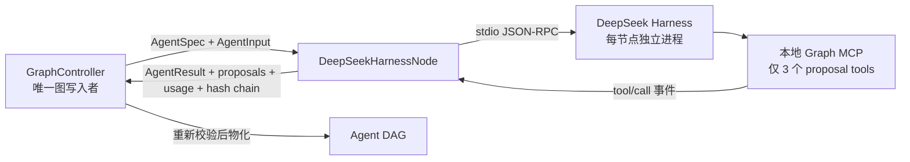

# DeepSeek Harness 节点运行时

Graph Agent 的线上 DeepSeek 路径已从“项目自行维护模型工具循环”迁移为“官方 DeepSeek Harness 执行节点,GraphController 治理图”。这不是把整个项目交给 Harness:两层的职责刻意分开。



## 责任边界

- `DeepSeekHarnessNode` 负责单节点的模型循环、工具调用、官方事件流和 Token 用量采集。
- 本地 MCP 仅提供 `propose_spawn`、`send_message`、`request_skip_context`;调用结果明确表示“已提议,尚未批准”。
- 父进程不信任 MCP 的结果,会根据原始 `tool/call` 参数再次运行 `ProposalCollector`。
- `GraphController` 继续执行节点数、代际、边数、工具子集、预算份额、循环检测、结果绑定哈希等全局校验,并保持唯一写入权。
- 原 `AgentNode + ModelAdapter` 保留为离线测试、可注入模型和非 Harness provider 的兼容执行面。

## 进程与取消模型

官方 TypeScript SDK 通过换行 JSON-RPC 启动完整 Harness 子进程,目前没有独立的“取消本轮但保留进程”接口。因此这里采用每节点一次隔离进程:

1. 为节点创建权限为当前用户可读写的临时 Harness home 和启动 patch。
2. 启动 `sdk-minimal`,完成节点运行。
3. Abort、超时、超出 turn/tool budget 时立即关闭整个节点进程。
4. 等待关闭完成后删除该节点临时目录。

这个选择牺牲少量进程启动延迟,换来明确的取消语义、节点间状态隔离和无残留密钥。多轮用户对话仍由 Studio 的 conversation 输入承载;Controller checkpoint 负责图状态和已完成结果。

## 最小权限配置

上游 `sdk-minimal` 面向编码 Agent,默认仍包含 `danger-full-access` 的持久 Shell。Graph Agent 的 overlay 显式禁用:

- sandbox / sandbox-policy;
- 通用 subprocess / jobs 服务;
- PTY、Bash、PowerShell terminal;
- persistent Bash / PowerShell 工具;
- MCP resource 浏览工具。

随后只挂载本项目的 proposal MCP。上游 SDK 子进程接收的是白名单环境变量,不会继承宿主进程中的其他 `KEY`、`TOKEN`、`SECRET` 等变量。页面提交的 DeepSeek API Key 只作为当前子进程环境变量存在,不进入事件链、checkpoint、图快照或工具输出。

## 预算与结果映射

- Harness 的每个 `turn/start` 与 `tool/call` notification 都被实时计数;超过节点预算即关闭进程。
- `assistant/message.data.usage` 被累计为 Graph Agent 的 `Usage`。
- Harness 事件只投影为摘要事件;tool 参数进入哈希输入,不以明文写入 Graph Agent 事件元数据。
- 终态继续使用 `resultBindingHash`,绑定 output、usage、error 和全部 proposals,所以 Controller 的摄取校验无需放宽。
- 无最终文本、Token 超额、协议/进程异常均生成脱敏且可判定是否重试的失败结果。

## 版本与升级策略

- `@deepseek-ai/dsh-sdk-client` 与其 `@deepseek-ai/dsh` 运行时精确锁定为 `0.1.5-rc.3`;官方项目仍标记为 Developer Preview,升级必须先验证 profile/事件协议。
- MCP SDK 使用与上游 `^1.12.0` 兼容且已修复已知安全公告的 `1.30.0`。
- 不启用 Harness 自带 subagent,避免出现绕过 GraphController 的第二套隐藏拓扑。
- 当前 Studio 不向 Harness 暴露任意本地业务工具;后续工具必须逐个建立 typed schema、权限映射、超时/幂等策略与 Controller 审批边界。

官方资料:

- [DeepSeek Harness](https://github.com/deepseek-ai/deepseek-harness)
- [TypeScript SDK client](https://github.com/deepseek-ai/deepseek-harness/tree/master/packages/sdk/client)
- [Safety policy](https://github.com/deepseek-ai/deepseek-harness/blob/master/SAFETY.md)

## 验证

```bash
npm run typecheck
npm run build
npm test
npm run smoke:harness
npm audit --omit=dev
```

单测通过假的 Harness runtime 验证成功、取消、预算终止、提案映射、事件链和密钥不落结果;本地集成 smoke test 还会启动真实官方 Harness 子进程完成 SDK 握手,但不会在 CI 中消耗真实 API Key。
